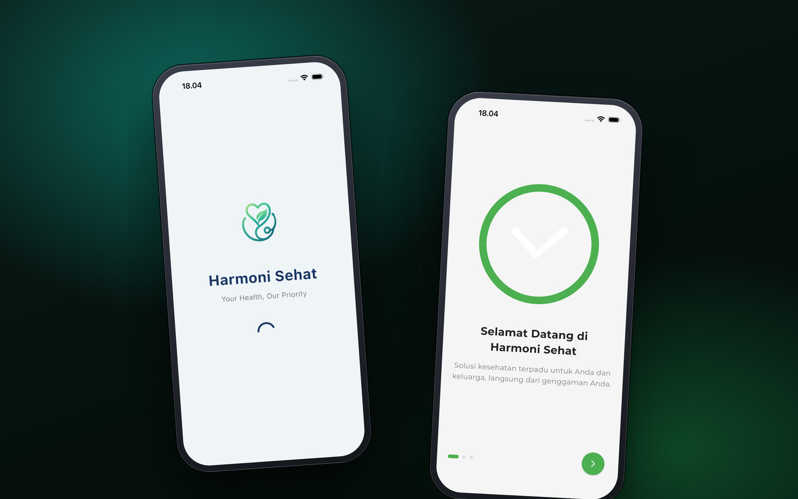
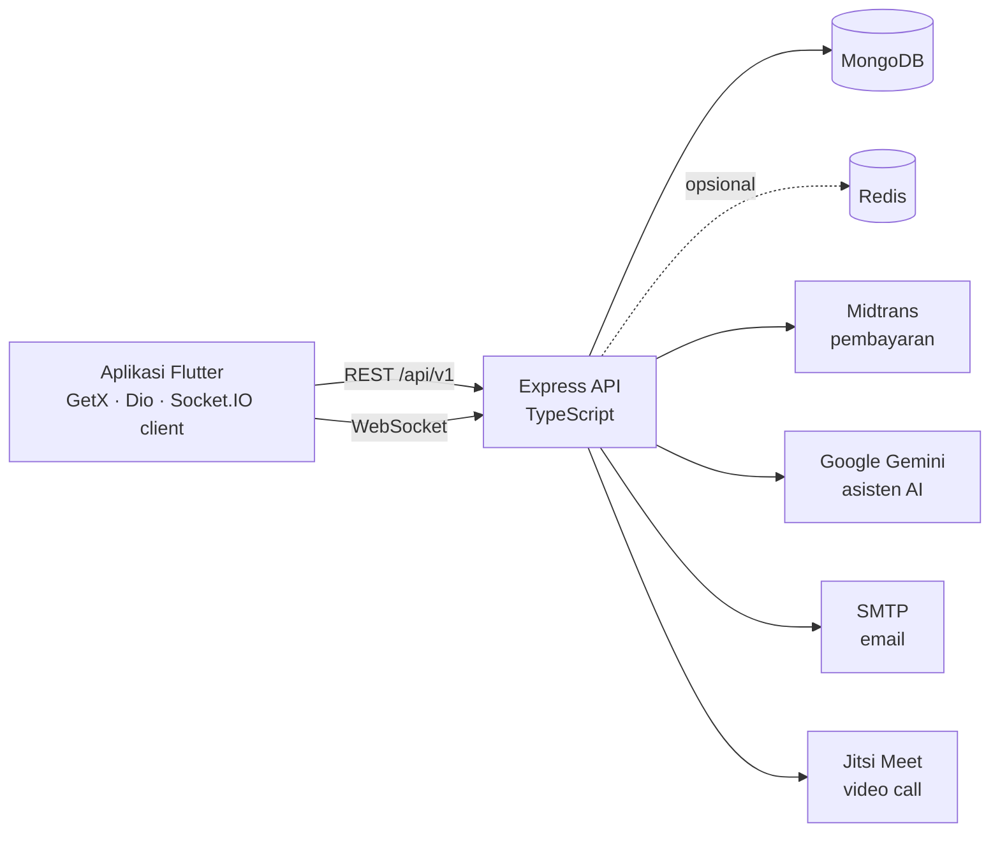

<div align="right">

[English](README.md) · **Bahasa Indonesia**

</div>

# Harmoni Sehat — Platform Telehealth



[](https://flutter.dev)
[](https://nodejs.org)
[](https://www.typescriptlang.org)
[](https://www.mongodb.com)
[](https://www.docker.com)
[](LICENSE)

**Harmoni Sehat** adalah platform telehealth full-stack yang menghubungkan **pasien, dokter, klinik, dan apotek**. Pasien dapat mencari dokter, memesan dan membayar konsultasi, mengobrol secara real-time atau bergabung ke video call, menerima resep digital, dan memesan obat. Dokter, apoteker, dan administrator masing-masing memiliki perangkat kerja sendiri.

## Daftar isi

- [Fitur](#fitur)
- [Tangkapan layar](#tangkapan-layar)
- [Arsitektur](#arsitektur)
- [Teknologi](#teknologi)
- [Memulai](#memulai)
- [Konfigurasi](#konfigurasi)
- [Ikhtisar API](#ikhtisar-api)
- [Pengujian](#pengujian)
- [Struktur repositori](#struktur-repositori)
- [Lisensi](#lisensi)
- [Penulis](#penulis)

## Fitur

**Pasien**
- Mencari dokter, lalu memesan slot konsultasi dan membayar secara online.
- Chat real-time (Socket.IO) dan tautan video konsultasi (Jitsi Meet) untuk setiap janji temu.
- Rekam medis dan linimasa medis, dengan ekspor PDF.
- Resep digital yang bisa ditebus di apotek, serta toko obat dan keranjang.
- Pengingat minum obat dan asisten kesehatan berbasis AI (Google Gemini).
- Pencatatan persetujuan (*consent*) dan penghapusan akun yang dikonfirmasi dengan password.

**Dokter**
- Jadwal praktik per klinik, booking, dan konsultasi.
- Rekam medis dan resep digital, serta ulasan pasien.

**Apoteker**
- Resep masuk dan pesanan obat, dengan pelacakan status pesanan (menunggu, diproses, dikirim, diterima) dan stok obat.

**Administrator**
- Verifikasi pendaftaran dokter dan apoteker (nomor izin profesi seperti SIPA).
- Statistik platform dan log aktivitas.

**Keamanan**
- Kontrol akses berbasis peran, token akses JWT berumur pendek dengan refresh token, dan validasi input dengan Zod.
- Header `helmet`, pembatasan laju (*rate limiting*), dan sanitasi terhadap NoSQL injection.
- Enkripsi AES-256-GCM opsional untuk kolom medis yang sensitif (atur `ENCRYPTION_KEY`).

## Tangkapan layar

Aplikasi seluler dibangun dengan Flutter. Gambar di bawah menampilkan layar splash dan onboarding; antarmuka aplikasi berbahasa Indonesia.


## Arsitektur



API disusun secara modular: setiap domain (booking, konsultasi, resep, pesanan obat, toko, dan seterusnya) memiliki route, controller, service, dan validasi sendiri di `harmoni_sehat_backend/src/api/`.

## Teknologi

| Lapisan | Teknologi |
|---|---|
| Klien seluler | Flutter (Dart), GetX, Dio, Socket.IO client, secure storage |
| Backend | Node.js, TypeScript, Express, Zod, Socket.IO |
| Database | MongoDB (Mongoose), Redis (opsional) |
| Integrasi | Midtrans (pembayaran), Google Gemini (AI), Nodemailer (email), Jitsi Meet (video) |
| Kualitas | Jest, Supertest, mongodb-memory-server, ESLint, Prettier |
| Infrastruktur | Docker Compose (API, MongoDB 7, Redis 7) |

## Memulai

### Opsi A: Docker (tercepat)

```bash
cp harmoni_sehat_backend/.env.example harmoni_sehat_backend/.env   # isi JWT_SECRET
docker compose up --build
docker compose exec api node dist/utils/seeder.js                  # opsional: data demo (non-produksi)
```

API kemudian tersedia di `http://localhost:8000/api/v1`.

### Opsi B: manual

```bash
# Backend (butuh MongoDB)
cd harmoni_sehat_backend
cp .env.example .env        # WAJIB isi JWT_SECRET dan MONGO_URI
npm install
npm run seed                # data demo
npm run dev

# Frontend
cd harmoni_sehat_frontend
flutter pub get
flutter run --dart-define=API_BASE_URL=http://<IP_KOMPUTER_ANDA>:8000/api/v1
```

Gunakan IP LAN komputer Anda untuk perangkat fisik. Di emulator Android pakai `10.0.2.2`; di simulator iOS cukup `127.0.0.1`.

### Akun demo

Seeder membuat akun fiktif untuk penggunaan lokal saja. Semuanya memakai password `Harmoni123!`:

| Peran | Email |
|---|---|
| Admin | `admin@harmoni.test` |
| Klinik | `klinik@harmoni.test` |
| Apoteker | `apoteker@harmoni.test` |
| Dokter | `dokter1@harmoni.test` … `dokter4@harmoni.test` |
| Pasien | `pasien@harmoni.test` |

> Seeder menolak berjalan ketika `NODE_ENV=production`. Jangan pernah memakai ulang kredensial ini di luar pengembangan lokal.

## Konfigurasi

Salin `harmoni_sehat_backend/.env.example` menjadi `.env`. Variabel utamanya:

| Variabel | Wajib | Fungsi |
|---|---|---|
| `JWT_SECRET` | **Ya** | Kunci penanda tangan token akses (gunakan string acak yang panjang) |
| `MONGO_URI` | **Ya** | String koneksi MongoDB |
| `PORT`, `CORS_ORIGINS`, `PUBLIC_BASE_URL` | Tidak | Port server, origin yang diizinkan (batasi di produksi), URL publik |
| `JWT_EXPIRES_IN`, `REFRESH_TOKEN_DAYS` | Tidak | Masa berlaku token akses dan refresh token |
| `ENCRYPTION_KEY` | Tidak | Mengaktifkan enkripsi AES-256-GCM untuk kolom medis yang sensitif |
| `GEMINI_API_KEY`, `GEMINI_MODEL` | Tidak | Asisten kesehatan AI |
| `MIDTRANS_SERVER_KEY`, `MIDTRANS_IS_PRODUCTION` | Tidak | Pembayaran online |
| `EMAIL_HOST`, `EMAIL_PORT`, `EMAIL_USERNAME`, `EMAIL_PASSWORD`, `EMAIL_FROM` | Tidak | Email reset password dan notifikasi |
| `REDIS_URL` | Tidak | Koneksi Redis (opsional) |
| `FCM_SERVICE_ACCOUNT_PATH` | Tidak | Notifikasi push |

Jangan pernah meng-commit berkas `.env` asli Anda.

## Ikhtisar API

URL dasar: `/api/v1`. Autentikasi memakai `Authorization: Bearer <token>`.

Modul utama: `auth`, `me`, `patients`, `doctors`, `clinics`, `practiceSchedule`, `booking`, `consultation`, `chatMessage`, `medicalRecord`, `prescription`, `drug`, `drugCart`, `drugOrder`, `shop`, `payment`, `doctorReview`, `healthArticle`, `notification`, `gemini`, `admin`, `activityLog`.

Event chat real-time (Socket.IO): `chat:join`, `chat:message`, `chat:typing`, `chat:read`.

Referensi lengkap: [`docs/backend/api-reference.md`](docs/backend/api-reference.md).

## Pengujian

Backend memiliki tes integrasi (Jest + Supertest) yang berjalan di MongoDB in-memory, sehingga tidak perlu menyiapkan database:

```bash
cd harmoni_sehat_backend
npm test
```

Area yang dicakup: autentikasi, booking, alur toko, dan chat real-time. Aplikasi Flutter memiliki widget test (`flutter test`).

## Struktur repositori

```text
.
├── harmoni_sehat_backend/    API Express + TypeScript
│   ├── src/                  api/, models/, middlewares/, services/, sockets/, utils/
│   └── tests/                Tes integrasi
├── harmoni_sehat_frontend/   Aplikasi Flutter (Android, iOS)
│   └── lib/                  features/ (patient, doctor, pharmacist, admin, auth), core/, shared/
├── docs/
│   ├── backend/              Pengantar, panduan setup, referensi API, skema database
│   └── frontend/             Cara menjalankan aplikasi
├── docker-compose.yml        API, MongoDB, Redis
└── LICENSE
```

## Lisensi

Dirilis di bawah [Lisensi MIT](LICENSE).

## Penulis

**Rizky Eka Haryadi**  
[GitHub](https://github.com/Rizky28eka) · [LinkedIn](https://linkedin.com/in/rizkyeka) · [Portofolio](https://heyeka.vercel.app/projects/harmoni-sehat)
