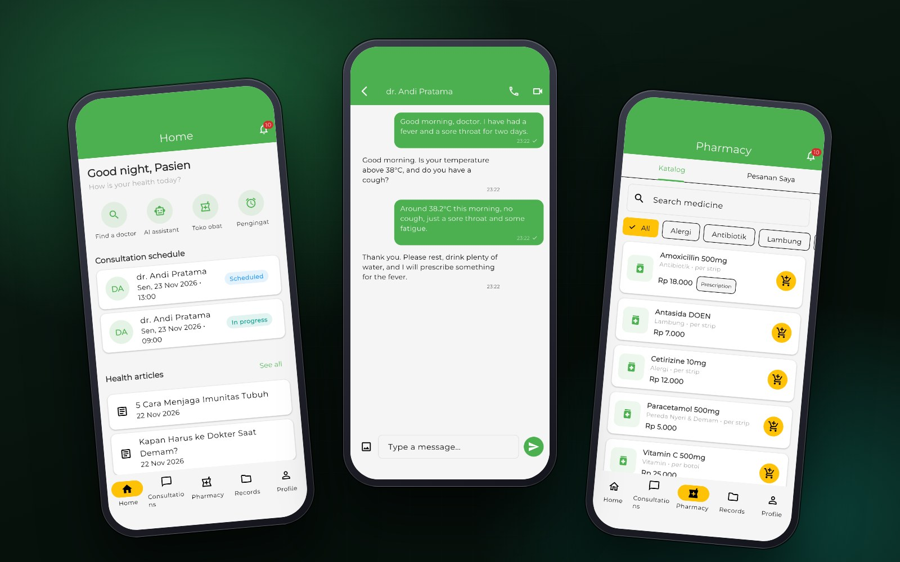
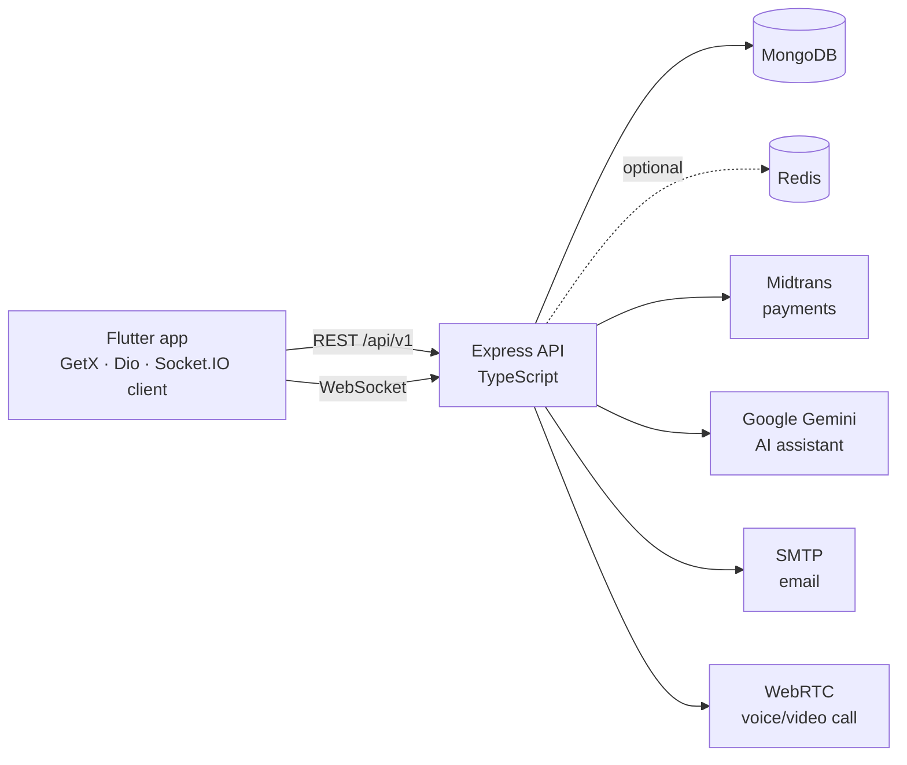

<div align="right">

**English** · [Bahasa Indonesia](README.id.md)

</div>

# Harmoni Sehat — Telehealth Platform



[](https://flutter.dev)
[](https://nodejs.org)
[](https://www.typescriptlang.org)
[](https://www.mongodb.com)
[](https://www.docker.com)
[](LICENSE)

**Harmoni Sehat** ("Harmonious Health") is a full-stack telehealth platform that connects **patients, doctors, clinics, and pharmacies**. Patients find a doctor, book and pay for a consultation, chat in real time or join a video call, receive e-prescriptions, and order medicine, while doctors, pharmacists, and administrators each get their own tools.

## Table of contents

- [Features](#features)
- [Screenshots](#screenshots)
- [Architecture](#architecture)
- [Tech stack](#tech-stack)
- [Getting started](#getting-started)
- [Configuration](#configuration)
- [API overview](#api-overview)
- [Testing](#testing)
- [Repository structure](#repository-structure)
- [License](#license)
- [Author](#author)

## Features

**Patients**
- Browse and search doctors, then book a consultation slot and pay online.
- Real-time chat (Socket.IO) and in-app voice/video calls (WebRTC, signaling over Socket.IO) for each appointment.
- Medical records and a medical timeline, with PDF export.
- E-prescriptions that can be redeemed at a pharmacy, plus a medicine shop and cart.
- Medication reminders and an AI health assistant (Google Gemini).
- Consent tracking and account deletion confirmed by password.

**Doctors**
- Practice schedules per clinic, bookings, and consultations.
- Digital medical records and prescriptions, and patient reviews.

**Pharmacists**
- Incoming prescriptions and drug orders, with order status tracking (pending, processing, shipped, delivered) and drug stock.

**Administrators**
- Verification of doctor and pharmacist registrations (professional license numbers such as SIPA).
- Platform statistics and an activity log.

**Security**
- Role-based access control, short-lived JWT access tokens with refresh tokens, and input validation with Zod.
- `helmet` headers, rate limiting, and sanitization against NoSQL injection.
- Optional AES-256-GCM encryption of sensitive medical fields (set `ENCRYPTION_KEY`).

## Screenshots

The mobile app is built with Flutter. The images below show the splash and onboarding screens; the application interface is in Indonesian.


## Architecture



The API follows a modular layout: each domain (booking, consultation, prescription, drug orders, shop, and so on) has its own routes, controller, service, and validation under `harmoni_sehat_backend/src/api/`.

## Tech stack

| Layer | Technology |
|---|---|
| Mobile client | Flutter (Dart), GetX, Dio, Socket.IO client, secure storage |
| Backend | Node.js, TypeScript, Express, Zod, Socket.IO |
| Database | MongoDB (Mongoose), Redis (optional) |
| Integrations | Midtrans (payments), Google Gemini (AI), Nodemailer (email), WebRTC (calls), Cloudinary/S3 (uploads) |
| Quality | Jest, Supertest, mongodb-memory-server, ESLint, Prettier |
| Infrastructure | Docker Compose (API, MongoDB 7, Redis 7) |

## Getting started

### Option A: Docker (quickest)

```bash
cp harmoni_sehat_backend/.env.example harmoni_sehat_backend/.env   # set JWT_SECRET
docker compose up --build
docker compose exec api node dist/utils/seeder.js                  # optional demo data (non-production)
```

The API is then available at `http://localhost:8000/api/v1`.

### Option B: manual

```bash
# Backend (needs MongoDB)
cd harmoni_sehat_backend
cp .env.example .env        # REQUIRED: set JWT_SECRET and MONGO_URI
npm install
npm run seed                # demo data
npm run dev

# Frontend
cd harmoni_sehat_frontend
flutter pub get
flutter run --dart-define=API_BASE_URL=http://<YOUR_IP>:8000/api/v1
```

Use your machine's LAN IP for a physical device. On the Android emulator use `10.0.2.2`; on the iOS simulator `127.0.0.1` works.

### Demo accounts

The seeder creates fictional accounts for local use only. All of them use the password `Harmoni123!`:

| Role | Email |
|---|---|
| Admin | `admin@harmoni.test` |
| Clinic | `klinik@harmoni.test` |
| Pharmacist | `apoteker@harmoni.test` |
| Doctors | `dokter1@harmoni.test` … `dokter4@harmoni.test` |
| Patient | `pasien@harmoni.test` |

> The seeder refuses to run when `NODE_ENV=production`. Never reuse these credentials outside local development.

## Configuration

Copy `harmoni_sehat_backend/.env.example` to `.env`. The main variables:

| Variable | Required | Purpose |
|---|---|---|
| `JWT_SECRET` | **Yes** | Signing key for access tokens (use a long random string) |
| `MONGO_URI` | **Yes** | MongoDB connection string |
| `PORT`, `CORS_ORIGINS`, `PUBLIC_BASE_URL` | No | Server port, allowed origins (restrict in production), public URL |
| `JWT_EXPIRES_IN`, `REFRESH_TOKEN_DAYS` | No | Access-token lifetime and refresh-token validity |
| `ENCRYPTION_KEY` | No | Enables AES-256-GCM encryption of sensitive medical fields |
| `GEMINI_API_KEY`, `GEMINI_MODEL` | No | AI health assistant |
| `MIDTRANS_SERVER_KEY`, `MIDTRANS_IS_PRODUCTION` | No | Online payments |
| `EMAIL_HOST`, `EMAIL_PORT`, `EMAIL_USERNAME`, `EMAIL_PASSWORD`, `EMAIL_FROM` | No | Password-reset and notification email |
| `REDIS_URL` | No | Redis connection (optional) |
| `FCM_SERVICE_ACCOUNT_PATH` | No | Push notifications |

Never commit your real `.env` file.

## API overview

Base URL: `/api/v1`. Authentication uses `Authorization: Bearer <token>`.

Main modules: `auth`, `me`, `patients`, `doctors`, `clinics`, `practiceSchedule`, `booking`, `consultation`, `chatMessage`, `medicalRecord`, `prescription`, `drug`, `drugCart`, `drugOrder`, `shop`, `payment`, `doctorReview`, `healthArticle`, `notification`, `gemini`, `admin`, `activityLog`.

Real-time chat events (Socket.IO): `chat:join`, `chat:message`, `chat:typing`, `chat:read`.

Full reference: [`docs/backend/api-reference.md`](docs/backend/api-reference.md). Interactive Swagger UI at `/api/docs` (OpenAPI at `/api/openapi.json`).

## Testing

The backend has integration tests (Jest + Supertest) that run against an in-memory MongoDB, so no database setup is needed:

```bash
cd harmoni_sehat_backend
npm test
```

Covered areas: authentication, booking, the shop flow, and real-time chat. The Flutter app has widget tests (`flutter test`).

## Repository structure

```text
.
├── harmoni_sehat_backend/    Express + TypeScript API
│   ├── src/                  api/, models/, middlewares/, services/, sockets/, utils/
│   └── tests/                Integration tests
├── harmoni_sehat_frontend/   Flutter app (Android, iOS)
│   └── lib/                  features/ (patient, doctor, pharmacist, admin, auth), core/, shared/
├── docs/
│   ├── backend/              Introduction, setup guide, API reference, database schema
│   └── frontend/             How to run the app
├── docker-compose.yml        API, MongoDB, Redis
└── LICENSE
```

## License

Released under the [MIT License](LICENSE).

## Author

**Rizky Eka Haryadi**  
[GitHub](https://github.com/Rizky28eka) · [LinkedIn](https://linkedin.com/in/rizkyeka) · [Portfolio](https://heyeka.vercel.app/projects/harmoni-sehat)
